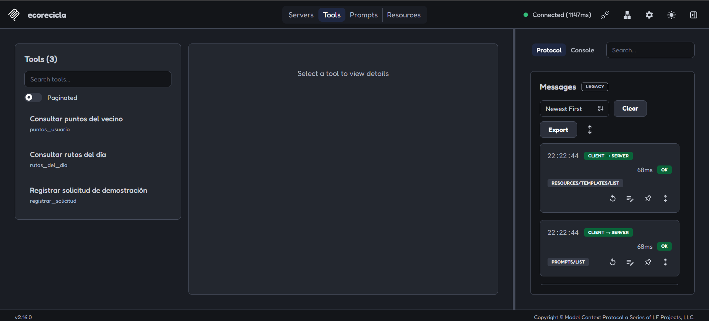
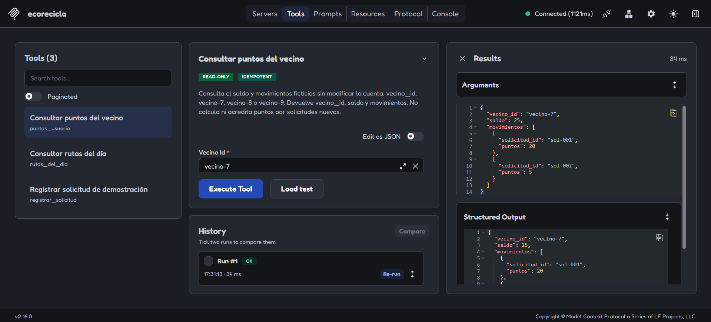
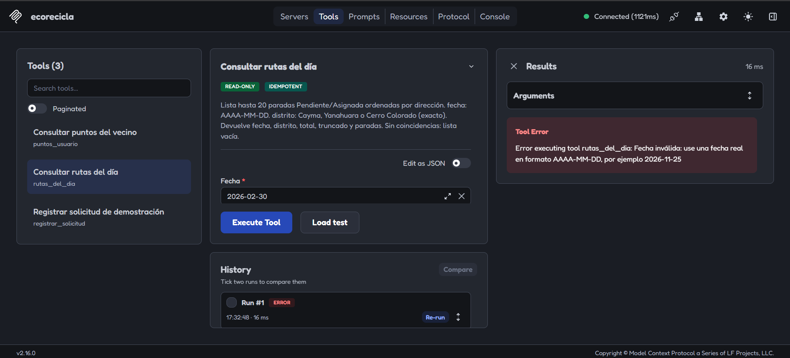

# E3 — MCP Inspector: evidencia y capturas

Responsable: Andrés, Persona 1.
Servidor: EcoRecicla AQP.
Fecha de verificación: 25/11/2026.

## Estado de la evidencia

El servidor fue verificado mediante el cliente MCP sobre stdio,
MCP Inspector CLI 2.16.0 y la interfaz gráfica de MCP Inspector.

Las tres capturas realizadas por Andrés se encuentran en `capturas/`.
Los resultados de Inspector CLI se conservan en `evidencias/`.

## Ejecución de Inspector

Desde la raíz del repositorio, con el entorno `.venv` activado:

```bash
npx -y @modelcontextprotocol/inspector@2.16.0 python agentes/mcp/servidor_mcp/ecorecicla_mcp.py
```

Se abrió la URL local indicada en la terminal y se conectó el servidor
mediante transporte stdio. Inspector mostró el estado Connected.

## Captura 1: catálogo

- [x] Captura guardada en `capturas/01-catalogo.png`.



### Resultado

El catálogo muestra tres herramientas:

- `puntos_usuario`: consulta el saldo y los movimientos del vecino.
- `rutas_del_dia`: consulta las paradas de una fecha y distrito.
- `registrar_solicitud`: crea una solicitud de demostración.

El contrato del servidor establece que `registrar_solicitud` es la
única herramienta de escritura. Está anotada con `readOnlyHint=false`
y `destructiveHint=false`. La implementación crea un archivo nuevo
sin sobrescribir los existentes; las anotaciones describen ese
comportamiento, pero no lo garantizan por sí solas.

## Captura 2: llamada correcta

- [x] Captura guardada en `capturas/02-llamada-correcta.png`.

Herramienta ejecutada: `puntos_usuario`.

### Entrada

```json
{
  "vecino_id": "vecino-7"
}
```



### Resultado

La consulta devolvió un saldo de 25 puntos y dos movimientos:

| Solicitud | Puntos |
| --- | --- |
| sol-001 | 20 |
| sol-002 | 5 |

La respuesta contiene salida estructurada y no indica error
(`isError=false`). El resultado permite consultar los datos del
vecino sin modificar su saldo.

## Captura 3: llamada con error

- [x] Captura guardada en `capturas/03-llamada-error.png`.

Herramienta ejecutada: `rutas_del_dia`.

### Entrada

```json
{
  "fecha": "2026-02-30",
  "distrito": "Cayma"
}
```



### Resultado

El servidor rechazó la fecha imposible y devolvió un resultado
de herramienta con `isError=true` y el mensaje:

> Fecha inválida: use una fecha real en formato AAAA-MM-DD,
> por ejemplo 2026-11-25.

La entrada tiene el formato de diez caracteres requerido, pero
no representa una fecha válida. Esto demuestra la validación
semántica del servidor.

El mensaje explica cómo corregir el argumento, de modo que
el agente puede reintentar la consulta con una fecha válida.