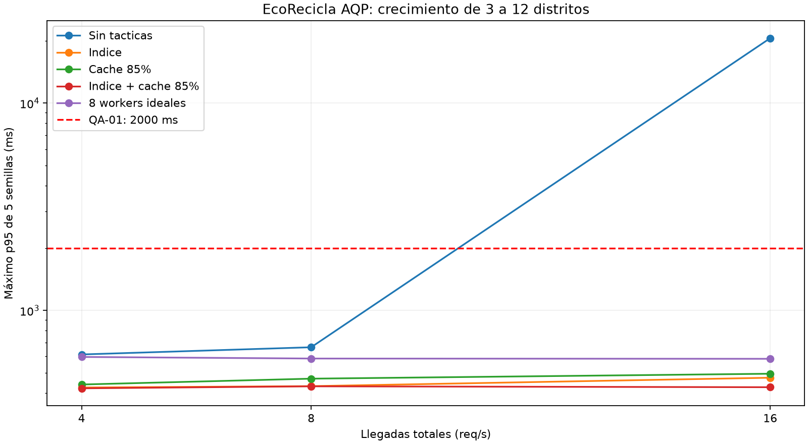
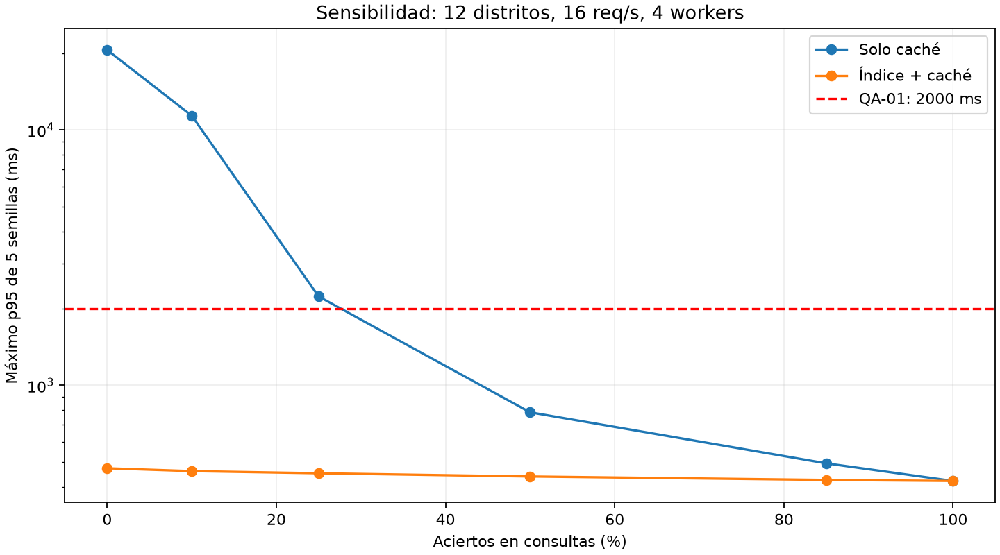

# E2 — Iteración 1 de ADD: rendimiento

Autor: Andrés. Estado: propuesta con evidencia simulada, pendiente de revisión del equipo.

## 1. Revisar entradas

Caso 10: EcoRecicla AQP crece de 3 a 12 distritos con reglas de puntos y horarios propios. Se mantienen drivers.md, ADR-001 (monolito modular Django/DRF), ADR-005 (Strategy y State), PostgreSQL, Redis y worker Celery del C4. Restricciones: un mes, tres desarrolladores sin DevOps dedicado y un VPS económico. No hay un precio mensual numérico en drivers.md y no se inventa uno.

Los identificadores siguientes corresponden a **Lab08**; consultar la [correspondencia con Lab04](../utilidad/escenarios.md). No se modifica el significado de los QA históricos.

## 2. Establecer el objetivo

**Lab08/QA-01 (H,M):** a 16 req/s agregadas de registro/consulta de recojos en 12 distritos, p95 de respuesta de API <= 2000 ms en el servidor actual.

Se sigue la iteración de rendimiento asignada a Andrés. QA-02=(H,H) tiene mayor dificultad y se aborda en la iteración 2 de Fabiana. Esta secuencia sigue el reparto y el ejemplo docente, pero requiere validar la diferencia con la instrucción literal de E2 de escoger el escenario más prioritario/difícil; no se cambia artificialmente su calificación.

## 3. Elegir elementos que se refinan

`eco.api.solicitudes`, sus consultas a `eco.db` y uso de `eco.cola` como caché Redis. El modelo representa workers de la API, no workers Celery ni distritos. Las notificaciones permanecen fuera del camino síncrono; la persistencia frente a fallos se trata en E4.

## 4. Elegir conceptos de diseño

| Concepto | Beneficio | Costo y trade-off | Decisión |
|---|---|---|---|
| Optimizar consultas e índices | Reduce servicio en lecturas; no depende de aciertos de caché | Espacio e impacto en escrituras; requiere medir plan de ejecución | Adoptar como base y validar en BD real |
| Caché de consultas autorizadas | Menor trabajo repetido | Memoria, invalidación, obsolescencia y riesgo de filtración entre distritos | Adoptar selectivamente, junto con índice |
| Aumentar de 4 a 8 workers | Más capacidad ideal en el modelo | CPU/RAM y conexiones; el VPS puede no soportarlo. No implica automáticamente otro servidor ni costo doble | Reserva; no necesaria bajo estos supuestos |
| Microservicios y Kubernetes | Despliegue/escalado por dominio | Operación distribuida, nuevas redes y despliegues incompatibles con equipo y plazo actuales | Rechazar para este crecimiento |

La simulación no mide microservicios. Su rechazo combina las restricciones verificadas del ADR-001 con la existencia de una alternativa más simple que cumple en el modelo; no demuestra que los microservicios sean lentos.

## 5. Instanciar elementos y asignar responsabilidades

- API: autenticar y resolver el distrito desde contexto autorizado; aplicar el filtro de acceso también a consultas que usen caché.
- PostgreSQL: evaluar un índice compuesto candidato por `distrito_id`, `estado` y fecha del recojo según consulta real, con EXPLAIN ANALYZE antes de fijar el orden final. La selección es diseño; este entregable no implementa una migración SQL.
- Redis: almacenar solo consultas cacheables, TTL propuesto de 30 s; la clave incluye distrito, alcance de permisos/usuario cuando proceda, filtros y versión. No usar solo el distrito si hay datos privados por usuario.
- Registros, confirmaciones y puntos: validar y persistir en PostgreSQL; no confirmar escrituras leyendo una caché. Invalidar claves afectadas después del commit.
- Mantener límites de módulos y Strategy/State del Lab07. E2 añade un experimento independiente, no cambia el código de dominio.

## 6. Esbozar vistas y registrar decisiones

Flujo de lectura: PWA → API (autorización distrital) → caché específica; ante miss, consulta filtrada a PostgreSQL y actualización de caché. Flujo de escritura: PWA → API → transacción PostgreSQL → invalidación después del commit.

Se reutilizan los identificadores C4 `eco.pwa`, `eco.api`, `eco.api.solicitudes`, `eco.db`, `eco.cola` y `eco.worker`. Flor documentará la decisión en ADR-006 y actualizará C4 con `[Lab08/QA-01]`. El nombre sugerido del ADR debe reflejar índices y caché, no solo caché.

### Supuestos del experimento

- Cola M/G/c FIFO sin límite: llegadas Poisson, tiempos de servicio lognormales y 4 servidores de atención equivalentes. No equivale a afirmar que el despliegue ya usa cuatro workers.
- 3, 6 y 12 distritos se modelan con 4, 8 y 16 req/s **totales**, respectivamente. Tasa proporcional hipotética, no derivada de mediciones ni de los 150 usuarios concurrentes del Lab04.
- Ventana de llegadas de 120 s desde cola vacía. Se terminan de atender todas las llegadas de la ventana aunque finalicen después; no se incluye una llegada fuera de la ventana. No es un experimento de régimen estacionario.
- Mezcla hipotética: 70% consultas y 30% registros; solo las consultas admiten caché. No se acreditan mejoras de índices a las escrituras en el modelo.
- Servicio base: exp(N(-1.35, 0.45²)) s, media aproximada 0.287 s. Lectura con índice: exp(N(-2.30, 0.40²)), media 0.109 s. Hit: exp(N(-4.6, 0.30²)), media 0.0105 s.
- Aciertos supuestos: 85% de las lecturas; no del total. TTL e invalidación no se simulan directamente, por lo que no se demuestra que 30 s produzcan 85% de aciertos.
- Parámetros adaptados del ejemplo docente: **no están calibrados con el MVP de EcoRecicla**. El efecto de indexación se presupone para explorar una hipótesis; debe comprobarse con un prototipo.
- Semillas 7, 17, 27, 37 y 47. Misma secuencia de llegadas entre alternativas para cada semilla, y muestras comparables de tipo de operación y servicio. p95 por rango más próximo. Se informa la mediana y el máximo de los cinco p95, no un p95 agrupado ni un intervalo de confianza.
- No se modelan latencia móvil, CPU compartida, locks de BD, costo adicional de miss/invalidación, saturación de conexiones, límites de memoria ni solicitudes fallidas. La medida es espera + servicio de la API, no extremo a extremo de PWA.

### Reproducción

Desde la raíz del repositorio, con Python 3.10+ y matplotlib:

```bash
python fitness/rendimiento.py
```

Los [datos CSV](evidencia/rendimiento.csv), [resultados completos](evidencia/resultados.md) y [sensibilidad](evidencia/sensibilidad.md) se regeneran con ese comando.





## 7. Analizar y verificar objetivo

### Evidencia calculada: 12 distritos y 16 req/s

| Alternativa | Mediana p95, cinco semillas (ms) | Máximo p95 (ms) | Todas <= 2000 ms |
|---|---:|---:|---|
| Sin tácticas | 18332.5 | 20570.7 | No |
| Índice | 457.0 | 473.6 | Sí |
| Solo caché 85% | 463.1 | 495.1 | Sí |
| Índice + caché 85% | 413.1 | 426.2 | Sí |
| 8 workers ideales | 562.6 | 584.3 | Sí |

La utilización teórica base es 16 × 0.287 / 4 ≈ 1.15: la llegada supera la capacidad media. Su resultado de 120 s describe una cola creciente, no latencia estable a largo plazo. Con índices, servicio medio mixto ≈ 0.162 s y utilización ≈ 0.65. Con índice + caché ≈ 0.104 s y utilización ≈ 0.41.

**Conclusión acotada:** índice + caché cumple Lab08/QA-01 en las cinco ejecuciones del modelo. Solo índice también basta. La caché es una optimización adicional propuesta por menor demanda de servicio, no una condición necesaria para cumplir 2000 ms. Se puede posponer si su complejidad de autorización/invalidez supera ese beneficio.

### Sensibilidad, trade-off y límites

Con caché vacía (0% hits), solo caché alcanza máximo p95=20570.7 ms; con índice+caché, 473.6 ms. A 25% de aciertos sin índice, 2228.7 ms; a 50%, 784.2 ms. No se afirma que el umbral exacto esté en 25%: solo se muestrearon esos puntos.

Propuesta inicial de IA que se descarta en esta iteración: **usar solo caché como garantía de QA-01**. La ejecución con caché fría refuta esa garantía; se conserva el índice como base. Esta es la corrección sustentada por la evidencia de esta sesión, no una evaluación cruzada de otro grupo.

El trade-off aceptado para consultas cacheables es latencia frente a frescura (TTL propuesto 30 s) y complejidad de aislamiento. Los puntos y confirmaciones se resuelven en BD. El aislamiento QA-04 requiere pruebas específicas; no se demuestra con esta simulación.

Riesgos pendientes: calibración no real, saturación del VPS, caché con permisos incompletos, obsolescencia y distribución desigual entre distritos. La prueba siguiente debe usar el endpoint y datos reales con carga representativa, más pruebas negativas de autorización. Ningún resultado de E2 certifica rendimiento de producción.

### Contrato de integración para Fabiana (E5)

Importación disponible sin ejecutar gráficos:

```python
from fitness.rendimiento import evaluar_qa01, SEMILLAS, UMBRAL_P95_MS

def test_qa01_rendimiento():
    assert all(evaluar_qa01(s) <= UMBRAL_P95_MS for s in SEMILLAS)
```

`evaluar_qa01(semilla)` devuelve un `float` en milisegundos. Este fragmento es para integrar en E5, cuyo archivo tests/test_fitness.py corresponde a Fabiana. Solo protege la hipótesis del modelo; no detecta un índice eliminado de una base de datos real.
