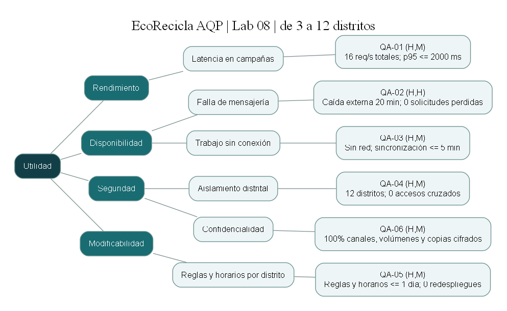

# E1 — Árbol de utilidad de EcoRecicla AQP

Autor: Andrés. Propuesta para revisión del Grupo B-10. Alcance: Lab 08, crecimiento de 3 a 12 distritos.

## Identificadores y trazabilidad

Los QA de este documento tienen alcance **Lab08**. No se renumeran los escenarios históricos de drivers.md ni sus ADR. En documentos nuevos escribir, por ejemplo, `Lab08/QA-01`; la etiqueta breve del árbol es `QA-01`.

| Lab 08 | Relación con Lab 04 |
|---|---|
| QA-01 rendimiento | Extiende el interés de QA-03; cambia de descarga de rutas a mezcla de registro/consulta de recojos. 150 usuarios concurrentes no equivalen a 16 req/s. |
| QA-02 disponibilidad | Amplía el driver de fiabilidad ante fallo del proveedor. |
| QA-03 offline | Relacionado con QA-02 de Lab04, que exige 5 segundos. Los 5 minutos del reparto son para un escenario ampliado; no sustituyen ni demuestran el requisito previo. Acordar volumen del lote y reconciliar ambos antes de aceptar E4. |
| QA-04 aislamiento | Nuevo escenario crítico para 12 distritos. |
| QA-05 modificabilidad | Refina QA-01 de Lab04 (2 días-persona) hacia configuración en <= 1 día, incluyendo horarios. |
| QA-06 confidencialidad | Descompone la restricción de protección de datos; no constituye por sí solo una evaluación legal. |

## Escenarios de seis partes

Calificación: (importancia para el negocio, dificultad técnica); H alta, M media, L baja. Los valores de carga son hipótesis de diseño, no mediciones del MVP.

### QA-01 — Rendimiento (H,M)

| Parte | Descripción |
|---|---|
| Fuente | Vecinos y recicladores de los 12 distritos |
| Estímulo | Registrar o consultar recojos a 16 req/s agregadas |
| Entorno | Campaña municipal simultánea, VPS actual disponible |
| Artefacto | eco.api.solicitudes y eco.db |
| Respuesta | Procesar registros y consultas autorizados |
| Medida | p95 de espera + servicio de API <= 2000 ms |

### QA-02 — Disponibilidad (H,H)

| Parte | Descripción |
|---|---|
| Fuente | Proveedor externo WhatsApp/SMS |
| Estímulo | Indisponibilidad total durante 20 minutos |
| Entorno | API y PostgreSQL disponibles; falla del proveedor externo |
| Artefacto | Solicitudes, outbox persistente y worker |
| Respuesta | Confirmar solicitudes en BD y dejar notificaciones pendientes para reintento |
| Medida | 0 solicitudes confirmadas perdidas; 100% registradas durante los 20 min |

### QA-03 — Disponibilidad (H,M)

| Parte | Descripción |
|---|---|
| Fuente | Reciclador en un distrito periférico |
| Estímulo | Registrar un recojo durante un corte de red móvil |
| Entorno | PWA previamente cargada; dispositivo operativo, almacenamiento disponible |
| Artefacto | eco.pwa, almacenamiento local y sincronización |
| Respuesta | Persistir localmente y sincronizar con idempotencia al recuperar red |
| Medida | 0 registros locales confirmados perdidos; sincronización <= 5 min después de reconectar |

### QA-04 — Seguridad (H,M)

| Parte | Descripción |
|---|---|
| Fuente | Usuario autenticado del distrito A |
| Estímulo | Solicitar por consulta o reporte datos del distrito B |
| Entorno | Operación concurrente con 12 distritos; permisos distritales |
| Artefacto | API, PostgreSQL y claves de caché |
| Respuesta | Autorizar según distrito del usuario; denegar accesos cruzados |
| Medida | 0 registros de otro distrito visibles en la matriz de pruebas cruzadas de 12 x 11 pares |

### QA-05 — Modificabilidad (H,M)

| Parte | Descripción |
|---|---|
| Fuente | Administrador autorizado |
| Estímulo | Dar de alta un distrito o cambiar sus factores de puntos y horarios |
| Entorno | Operación normal con configuración persistente existente |
| Artefacto | Configuración y módulo puntos; Strategy del Lab 07 |
| Respuesta | Validar y persistir configuración sin cambiar otros módulos |
| Medida | Cambio operativo <= 1 día de trabajo (8 horas); 0 redespliegues y 0 recompilaciones |

### QA-06 — Seguridad (H,M)

| Parte | Descripción |
|---|---|
| Fuente | Cliente API o administrador de infraestructura |
| Estímulo | Transmitir o almacenar contactos y direcciones |
| Entorno | Operación y respaldos de los 12 distritos |
| Artefacto | Canal HTTPS, volúmenes y copias de PostgreSQL |
| Respuesta | Usar cifrado en tránsito y reposo con gestión de claves |
| Medida | 100% de canales que transportan esos datos y 100% de volúmenes/copias que los contienen cifrados |

## Revisión crítica de prioridades propuesta con IA

Como punto de partida, la propuesta de IA para este trabajo reproduce QA-05=(M,M) del reparto. Se corrige explícitamente a **(H,M)** al contrastarla con drivers.md: modificabilidad es crítico y el detonante oficial exige reglas y horarios por distrito. Este ajuste cumple la lista de E1 (al menos un H,H o H,M en cada atributo crítico). El equipo debe revisar y ratificar esta propuesta; no se simula una aprobación que no ocurrió.

QA-06 se propone **(H,M)**, frente al (M,L) del reparto: el repositorio describe HTTPS, pero no aporta una verificación del cifrado de volúmenes/copias. No puede afirmarse que el cifrado del VPS esté resuelto. Si el equipo presenta evidencia podrá revisar la dificultad, manteniendo la importancia justificada. Registrar esta revisión real en la bitácora final.

QA-01=(H,M) por latencia en campaña; QA-02=(H,H) por persistencia y recuperación ante fallas; QA-03=(H,M) por sincronización e idempotencia; QA-04=(H,M) por aislamiento de 12 distritos.

## Orden de trabajo

QA-02 tiene mayor dificultad que QA-01. Se mantiene rendimiento como iteración 1 por el reparto y la secuencia del ejemplo docente; no se afirma que sea el escenario de mayor dificultad. La guía E2 pide elegir el más prioritario/difícil: validar con el docente esta excepción de orden o reordenar las iteraciones manteniendo responsables. QA-02 queda explícitamente a cargo de la iteración 2, y QA-04/QA-05 de la iteración 3.
