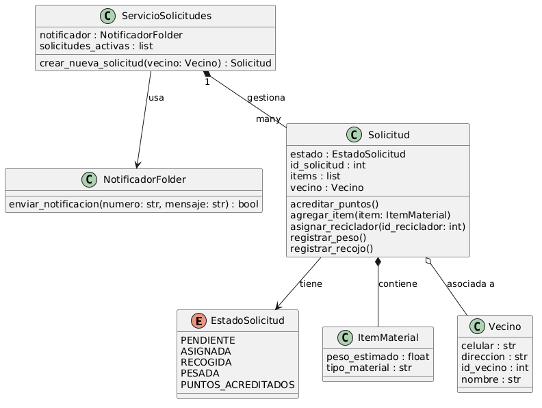

# E6: Reporte de Round-Trip (Ingeniería Directa e Inversa) - EcoRecicla AQP

## 1. Diagrama Compilado de Ingeniería Inversa
El diagrama de clases fue extraído automáticamente a partir del código fuente en Python utilizando la herramienta `pyreverse`.

## 2. Diferencias Observadas entre el Diseño y el Código Generado

A continuación se detallan las 3 discrepancias clave identificadas en el proceso de sincronización, evaluando sus causas y las acciones aplicadas:

1. **Diferencia 1: Mapeo de la Interfaz/Puerto en Python**
   - **Causa:** El diseño original de arquitectura proponía una interfaz pura para `NotificadorWhatsapp`. Al generar el código base en Python (que carece de la palabra clave `interface`), la IA implementó una clase tradicional (`NotificadorFolder`) con métodos vacíos.
   - **Acción:** Se aceptó la clase base como un sustituto conceptual de la interfaz y se documentó que actuará como la abstracción para el envío de alertas de recojo.

2. **Diferencia 2: Tipado dinámico en colecciones**
   - **Causa:** En el diagrama original se especificaba una relación estricta de uno a muchos usando arreglos fuertemente tipados. `pyreverse` interpretó la lista de Python (`List[ItemMaterial]`) simplemente como un tipo genérico `list` en el diagrama inverso.
   - **Acción:** Se añadieron anotaciones de tipo explícitas (`typing.List`) en el archivo `clases.py` para salvaguardar la consistencia estructural del dominio.

3. **Diferencia 3: Ausencia de la Enumeración Nativa en la visualización automática**
   - **Causa:** `pyreverse` requirió la herencia explícita de `enum.Enum` para identificar el tipo `EstadoSolicitud`. Al inicio, la herencia implícita generó una clase ordinaria en lugar de un enumerado UML.
   - **Acción:** Se refactorizó la declaración en el esqueleto de código para forzar el formato estricto de enumeración con los 5 estados del negocio.
