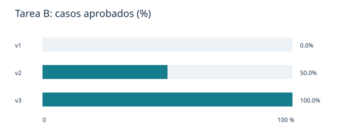

# Resultados Tarea B

| Versión | Casos aprobados | Tasa |
|---|---:|---:|
| v1 | 0/8 | 0.00 % |
| v2 | 4/8 | 50.00 % |
| v3 | 8/8 | 100.00 % |

## Regresiones
- v1 → v2: ninguna.
- v2 → v3: ninguna.

La mejor versión se selecciona tras revisar estas tasas, los fallos y el contenido.
Meta: al menos 85 % (con 8 casos, 7/8 = 87.5 %). Si no se alcanza, documentar la hipótesis.

